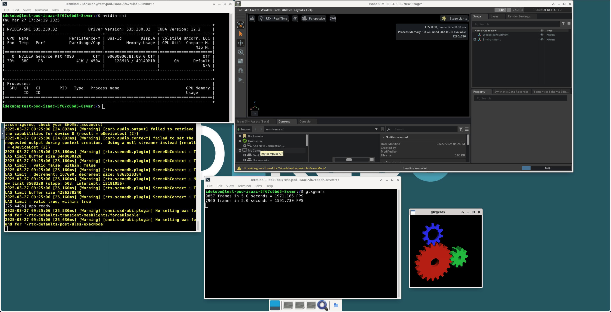

# IDEKUBE — Self-Hosted IDE & AI-Agent Fleet for Kubernetes

<p align="center">
    
</p>

[](LICENSE)
[](https://github.com/idekube-project/idekube-container/actions/workflows/publish.yml)
[](https://github.com/idekube-project/idekube-container/actions/workflows/publish-production.yml)
[](https://github.com/idekube-project/idekube-container/releases)
[](https://github.com/orgs/idekube-project/packages?repo_name=idekube-container)

**IDEKUBE** runs a fleet of browser-accessible developer environments — JupyterLab, Coder/VS Code, full Linux desktop (XFCE + noVNC), and AI-agent shells (Claude Code, opencode, Hermes) — on your own Kubernetes cluster. A self-hosted alternative to GitHub Codespaces, Gitpod, and Coder Cloud, built for **small engineering teams and research labs** that need per-user dev environments, shared GPUs/NPUs, and on-prem control. 

Runs on NVIDIA GPUs and Huawei Ascend NPUs; field-tested at **Cloud IDE Platform** developed by Shanghai Jiao Tong University Paris Elite Institute of Technology (SPEIT) and the **AI Teaching Practice Platform** developed by the Network & Information Center of Shanghai Jiao Tong University.

This repository holds everything: the image sources under `images/`, the shared install scripts and rootfs (`artifacts/`), the landing page (`frontend/`), the health server (`healthcheck/`), the QEMU pipeline, and the centralized build driven by `docker-bake.hcl`.

## Who it's for

- **Small engineering teams (5–50 devs)** who want Codespaces-style ephemeral dev containers without paying per-seat and without sending source to a SaaS.
- **Research labs and university courses** that need to give each student or researcher their own JupyterLab, IDE, and Linux desktop on shared GPUs or NPUs.
- **AI / agent teams** running Claude Code, opencode, or custom agents as a fleet — each agent gets an isolated container with a full developer toolchain.
- **Robotics & simulation groups** who need ROS 2 Jazzy, Gazebo, MoveIt, and Kathara network labs in a reproducible browser-accessible image.

## Use cases

- Self-hosted GitHub Codespaces / Gitpod / Coder Cloud alternative on your own Kubernetes cluster
- Shared GPU JupyterLab fleet for an ML research lab
- Per-student browser desktops for a university course (SPEIT runs the fleet at scale)
- AI-agent sandboxes: one Claude Code or opencode container per task or per user
- ROS 2 + Gazebo browser desktops for distributed robotics teams
- Network-emulation labs (Kathara) with no per-laptop setup
- Ascend NPU notebooks for teams on Huawei hardware

> **Note on the "gherkin badge":** the test suite is pytest + Playwright, not a Gherkin/BDD framework (Cucumber, behave, pytest-bdd, etc.), so a Gherkin-feature-count or Cucumber-report badge is not applicable.

## Repository Structure

### Build system (here)

| Path                            | Description                                          |
| ------------------------------- | ---------------------------------------------------- |
| `docker-bake.hcl`               | All bake targets, groups, dependency DAG, build args |
| `docker-bake.staging.hcl`       | Staging override (sets `STAGING_POSTFIX="-staging"`) |
| `docker-bake.production.hcl`    | Local production override (CI promotes instead)      |
| `Makefile`                      | Thin wrappers around `docker buildx bake` + tests    |
| `tests/`                        | pytest + Playwright suite, parametrized per branch   |
| `.github/workflows/ci.yml`      | Pull-request gate: static checks + build/test of affected images (`ci-ok`) |
| `.github/workflows/publish.yml` | Candidate builds + tests for `main` (`edge`), prereleases and dispatch |
| `.github/workflows/_build.yml`  | Reusable pipeline: native per-platform builds by digest → merge → tests |
| `.github/workflows/publish-production.yml` | Promotes a release's tested candidate by digest (builds nothing) |
| `.github/workflows/ghcr-cleanup.yml` | Weekly GHCR retention: staging tags and unreferenced untagged versions older than 30 days |
| `scripts/ci/bakeplan.py`        | CI plans from `bake --print`: affected targets, build matrix, digests, promotion |
| `scripts/tag-stable.sh`         | Post-publish stable-tag aliasing helper              |
| `qemu-builder/`                 | QEMU/Ansible nested-VM build pipeline                |

### Shared sources

| Directory                      | Description                                                       |
| ------------------------------ | ----------------------------------------------------------------- |
| [`artifacts/`](artifacts/)     | Shared install scripts and common rootfs overlay                  |
| [`frontend/`](frontend/)       | Vue.js landing page (built inside Docker via named context)       |
| [`healthcheck/`](healthcheck/) | Go health check server (compiled inside Docker via named context) |

These, and every `images/*` directory, were separate `idekube-container-*` repositories (git submodules) until 2026-11; their full history now lives here and the old repos are archived.

### Images

| Directory                                        | GHCR repo                         | Variants                                       | Base                             |
| ------------------------------------------------ | --------------------------------- | ---------------------------------------------- | -------------------------------- |
| [`images/featured-base/`](images/featured-base/) | `idekube-container-featured-base` | `base`                                         | `ubuntu:24.04` / `ascendai/cann` |
| [`images/featured/`](images/featured/)           | `idekube-container-featured`      | `speit`, `speit-ai`, `dind`, `kathara`, `ros2` | `featured/base`                  |
| [`images/coder-base/`](images/coder-base/)       | `idekube-container-coder-base`    | `base`                                         | `ubuntu:24.04`                   |
| [`images/coder/`](images/coder/)                 | `idekube-container-coder`         | `conda`                                        | `coder/base`                     |
| [`images/jupyter-base/`](images/jupyter-base/)   | `idekube-container-jupyter-base`  | `base`                                         | `ubuntu:24.04` / `ascendai/cann` |
| [`images/jupyter/`](images/jupyter/)             | `idekube-container-jupyter`       | `speit-ai`                                     | `jupyter/base`                   |
| [`images/agent-base/`](images/agent-base/)       | `idekube-container-agent-base`    | `base`                                         | `ubuntu:24.04`                   |
| [`images/agent/`](images/agent/)                 | `idekube-container-agent`         | `openclaw`, `hermes`                           | `agent/base`                     |

## Architecture

### Image flavors (JupyterLab, Coder, noVNC desktop, AI agent)

- **`featured/`** — Full Linux desktop in a browser: Coder IDE + noVNC (TurboVNC + VirtualGL) + SSH. Variants: `base`, `speit`, `speit-ai`, `dind`, `kathara`, `ros2`
- **`coder/`** — Coder / VS Code IDE only + SSH. Variants: `base`, `conda`
- **`jupyter/`** — JupyterLab notebook server only + SSH. Variants: `base`, `speit-ai`
- **`agent/`** — AI-agent runtime (Claude Code + opencode + document processing) + ttyd web terminal + SSH. Variants: `base`, `openclaw`, `hermes`

### Service endpoints

All services are reverse-proxied by Nginx on port 80:

| Endpoint    | Service                                               |
| ----------- | ----------------------------------------------------- |
| `/`         | Landing page (auto-detects available services)        |
| `/coder`    | Coder service                                         |
| `/jupyter`  | Jupyter service                                       |
| `/vnc`      | noVNC service                                         |
| `/agent`    | openclaw agent gateway                                |
| `/terminal` | ttyd web terminal                                     |
| `/ssh`      | Websocat-proxied SSH                                  |
| `/health`   | Health check endpoint (no auth, JSON, for k8s probes) |

### Build system at a glance

`docker buildx bake` reads `docker-bake.hcl` from the meta-repo root and:

1. Walks the dependency DAG via `target:` named contexts (no separate Python orchestrator).
2. Sets `--build-context artifacts=./artifacts`, `--build-context healthcheck-src=./healthcheck`, `--build-context frontend-src=./frontend` on every target so each Dockerfile only references its own image directory.
3. For matrix-expanded dual-lineup images, generates `<name>-universal` and `<name>-ascend` variants with the right `BASE_IMAGE` and `platforms`.
4. Tags base repos as `<VERSION>[-ascend][-staging]` and application repos as `<variant>-<VERSION>[-ascend][-staging]`.

Bake schedules independent targets in parallel and resolves dependencies automatically.

### Dependency graph

```text
featured/base ──> featured/speit
              ──> featured/speit-ai
              ──> featured/dind ──> featured/kathara
              ──> featured/ros2

coder/base ──> coder/conda

jupyter/base ──> jupyter/speit-ai

agent/base ──> agent/openclaw
           ──> agent/hermes
```

## Quick start: run an IDEKUBE container in Kubernetes

### Clone

```bash
git clone https://github.com/idekube-project/idekube-container.git
cd idekube-container
```

A clone from before 2026-11 still has the old submodules initialized; run `git submodule deinit -f --all && rm -rf .git/modules` once before pulling.

### Build locally (single arch)

```bash
# Single target, host arch, loaded into local docker
make bake TARGET=featured-base-universal
make bake TARGET=agent-openclaw

# Inspect the bake plan as JSON
make discover GROUP=universal
```

### Multi-arch build (staging)

```bash
# Builds for both linux/amd64 and linux/arm64
make bake-staging GROUP=universal

# Or push to GHCR with -staging tag postfix
make push-staging GROUP=universal
```

### Releasing

CI builds each release once and promotes the tested images; production never rebuilds.

```bash
gh release create v1.0.0 --prerelease --generate-notes   # publish-staging builds + tests the candidate
# wait for publish-staging; the release gets candidate.json (digests + test result)
gh release edit v1.0.0 --prerelease=false --latest        # publish-production retags those digests
```

Pull requests run `ci.yml`; pushes to `main` build and test `edge-staging`. `make push-production` and `make tag-stable` still exist for recovering from a broken pipeline, but they bypass the tested-candidate gate. Details: [CLAUDE.md](CLAUDE.md#cicd).

### Scoping a manual dispatch

publish-staging takes these `workflow_dispatch` inputs (plus `version`, `skip_base`, `base_tag`):

- `lineup` — `universal`, `ascend`, or `both` (default). Used when `targets` is empty.
- `targets` — bake target or group name. Empty (default) falls back to `lineup`; non-empty overrides.

When `targets` is set, `lineup` is ignored and the build matrix splits whatever `targets` resolves to per flavor, lineup and platform, each on a native runner: a group like `agent-ascend` or `agent-base-all` still produces its ascend images, built on arm64.

| Want to build… | Pass `targets` = |
|---|---|
| Just one image variant | `agent-base-ascend`, `featured-speit`, … (any single target name) |
| Both lineups of one variant | `<branch>-all` (e.g. `agent-base-all`) |
| One flavor × one lineup | `<flavor>-<lineup>` (e.g. `agent-ascend`, `featured-universal`) |
| Whole flavor across lineups | `featured`, `coder`, `jupyter`, `agent` |
| Whole lineup | `universal`, `ascend` |
| Everything | leave `targets` empty + `lineup=both` |

Run `make discover GROUP=universal` (or any other group name) to print the bake plan and confirm a group's contents before dispatching. Promotion skips the stable aliases when `targets` is set; run `scripts/tag-stable.sh` manually if you need a stable alias from a scoped release.

### Run a pre-built image

```yaml
# docker-compose.yml
services:
  idekube_container:
    image: ghcr.io/idekube-project/idekube-container-featured-base:stable
    ports:
      - "3000:80"
    volumes:
      - idekube_volume:/home/idekube
    deploy:
      resources:
        reservations:
          devices:
            - driver: nvidia
              count: 1
              capabilities: ["gpu"]
    ipc: host

volumes:
  idekube_volume:
    driver: local
```

## Available container images (GHCR)

Pre-built multi-arch container images are published on [GitHub Container Registry (GHCR)](https://github.com/orgs/idekube-project/packages?repo_name=idekube-container) — pull directly into your Kubernetes cluster.

### Universal tags (base image: `ubuntu:24.04`)

| Image               | Repo                              | Variant tag          | Description                                                       |
| ------------------- | --------------------------------- | -------------------- | ----------------------------------------------------------------- |
| `featured-base`     | `idekube-container-featured-base` | `<version>`          | Full desktop (XFCE + noVNC) + Coder + SSH + Miniconda + VirtualGL |
| `featured-speit`    | `idekube-container-featured`      | `speit-<version>`    | + dev tools + Python scientific stack + Iverilog + Digital        |
| `featured-speit-ai` | `idekube-container-featured`      | `speit-ai-<version>` | + dev tools + PyTorch conda environment                           |
| `featured-dind`     | `idekube-container-featured`      | `dind-<version>`     | + Docker-in-Docker (dockerd, buildx, compose)                     |
| `featured-kathara`  | `idekube-container-featured`      | `kathara-<version>`  | featured-dind + Kathara network emulation                         |
| `featured-ros2`     | `idekube-container-featured`      | `ros2-<version>`     | + ROS 2 Jazzy desktop-full + Gazebo + MoveIt                      |
| `coder-base`        | `idekube-container-coder-base`    | `<version>`          | Coder IDE + SSH, minimal install                                  |
| `coder-conda`       | `idekube-container-coder`         | `conda-<version>`    | coder-base + Miniconda                                            |
| `jupyter-base`      | `idekube-container-jupyter-base`  | `<version>`          | JupyterLab + SSH + Miniconda                                      |
| `jupyter-speit-ai`  | `idekube-container-jupyter`       | `speit-ai-<version>` | + scientific stack + PyTorch conda environment                    |
| `agent-base`        | `idekube-container-agent-base`    | `<version>`          | Claude Code + opencode + document toolchain + ttyd + SSH          |
| `agent-openclaw`    | `idekube-container-agent`         | `openclaw-<version>` | + openclaw gateway at `/agent`                                    |
| `agent-hermes`      | `idekube-container-agent`         | `hermes-<version>`   | + Hermes Agent CLI + gateway                                      |

### Ascend tags (base image: `ascendai/cann`, ARM64 only)

Tags are suffixed with `-ascend`.

| Image                    | Repo                              | Variant tag                       | Description                          |
| ------------------------ | --------------------------------- | --------------------------------- | ------------------------------------ |
| `featured-base`          | `idekube-container-featured-base` | `<version>-ascend`                | Full desktop with Ascend NPU support |
| `featured-speit-ai`      | `idekube-container-featured`      | `speit-ai-<version>-ascend`       | Desktop + PyTorch with Ascend NPU    |
| `jupyter-base`           | `idekube-container-jupyter-base`  | `<version>-ascend`                | JupyterLab with Ascend NPU support   |
| `jupyter-speit-ai`       | `idekube-container-jupyter`       | `speit-ai-<version>-ascend`       | JupyterLab + PyTorch with Ascend NPU |

## Runtime configuration

| Variable                  | Purpose                                      | Default     |
| ------------------------- | -------------------------------------------- | ----------- |
| `IDEKUBE_INIT_HOME`       | Initialize home from `/etc/skel`             | empty       |
| `IDEKUBE_PREFERED_SHELL`  | Path to preferred shell                      | `/bin/bash` |
| `IDEKUBE_USER_UID`        | Override container user UID                  | empty       |
| `IDEKUBE_AUTHORIZED_KEYS` | Base64-encoded SSH authorized keys           | empty       |
| `IDEKUBE_ACCESS_TOKEN`    | Nginx-level web auth token (excludes `/ssh`) | empty       |

### SSH proxy

```ssh-config
Host idekube
  User idekube
  ProxyCommand websocat --binary ws://$INGRESS_HOST$/ssh/
```

### Health check

Every container exposes `/health` (no auth) returning JSON for Kubernetes probes:

```json
{
  "status": "healthy",
  "branch": "featured/base",
  "entry": "/vnc/",
  "services": {
    "vnc":   { "port": 6081, "path": "/vnc/",  "healthy": true },
    "coder": { "port": 3000, "path": "/coder/", "healthy": true },
    "ssh":   { "port": 2222, "path": "/ssh",    "healthy": true }
  }
}
```

## Known issues

- For Kubernetes with Nginx Ingress Controller, the `nginx.org/websocket-services` annotation is required for the coder service.
- Chromium sandboxing and FUSE are not available in rootless mode. Use `privileged: true` to enable them.

## License

This project is licensed under the terms of the [MIT License](LICENSE). See the `LICENSE` file at the root of this repository for the full text.

The MIT License applies to everything in this repository: the build configuration (`docker-bake.hcl` and overrides), the image sources under `images/`, `artifacts/`, `frontend/`, `healthcheck/` and `qemu-builder/` (formerly separate repositories, now part of this one), helper scripts, the test suite, CI workflows and documentation.

Container images published by this project bundle third-party software distributed under its own license. Redistribution and use of the built images must comply with the terms of each bundled component, including but not limited to the operating system base image and the upstream projects acknowledged below.

## Acknowledgement

Many thanks to the authors of [docker-novnc](https://github.com/theasp/docker-novnc), [VirtualGL](https://github.com/VirtualGL/virtualgl), [TurboVNC](https://github.com/TurboVNC/turbovnc), and [Coder](https://github.com/coder/coder).
